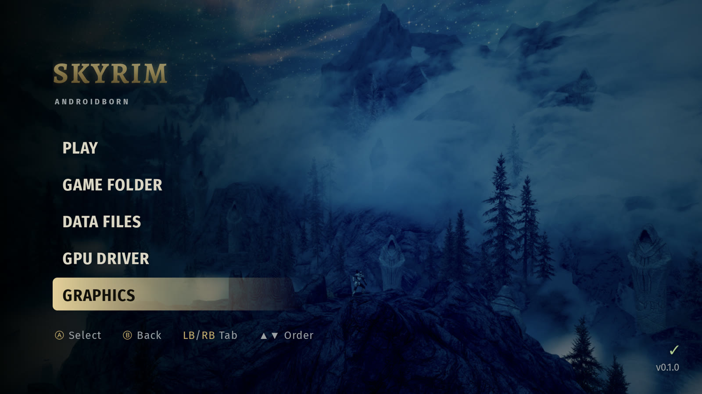
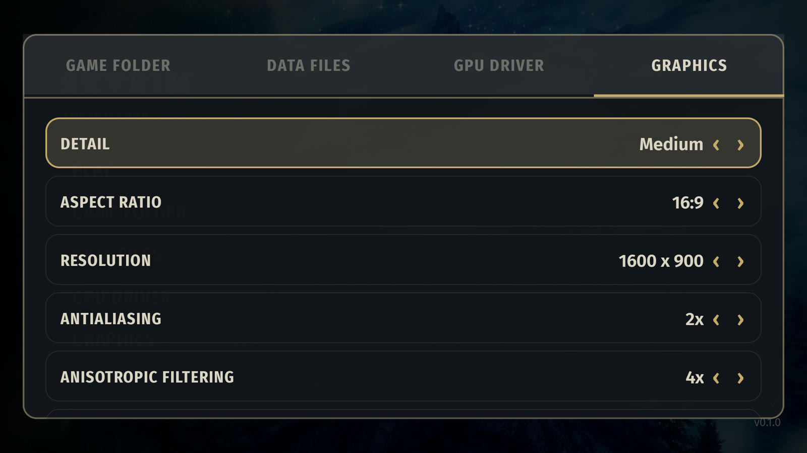
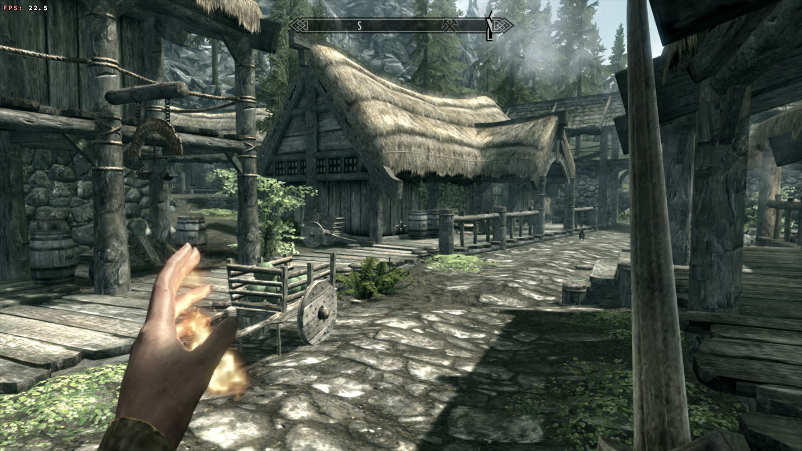

# Skyrim Androidborn

An unofficial native Android port of the 2011 PC version of *The Elder Scrolls
V: Skyrim* (not Special Edition). It runs on arm64 Android devices with
Vulkan 1.1.

Skyrim Androidborn is a fork of
[ttom795/Skyrim_Android](https://github.com/ttom795/Skyrim_Android), developed
independently. This repository contains no game code or data: you need your
own copy of the PC game.

Tested on a **Retroid Pocket G2** (Adreno A22, Android 15).

Current version: **0.1.3** — see [CHANGELOG.md](CHANGELOG.md).

## Screenshots







## Requirements

- arm64 Android 9 or newer with Vulkan 1.1.
- Around 3 GB of RAM and 7 GB of free storage.
- Your own PC copy of *The Elder Scrolls V: Skyrim* (2011), with the files
  listed below.
- A controller is recommended; the touch overlay works without one.

## Install

1. **Install the APK.** Open it on the device (allow "Install unknown apps"
   for your file manager or browser) or run `adb install -r
   Skyrim-Androidborn-<version>.apk`. Newer versions install over older ones.
2. **Copy the game files** into one folder outside `Android/data`, for example
   `Internal storage/Skyrim/`. The `Data` folder goes inside it, next to the
   exe and DLLs.
3. **Open the app**, choose **Game folder**, and pick that folder. Allow the
   storage prompt. The launcher lists anything missing.
4. **Pick your settings and tap Play.**

Everything the port writes goes into a `port` folder inside the Skyrim folder:
`log.txt`, `last_exit.txt` and your saves under
`port/save/Documents/My Games/Skyrim`. Uninstalling the app does not delete
your saves.

### Game files

Everything comes from your own PC install of the 2011 game:

| File | Notes |
|---|---|
| `TESV.exe` | 1.9.32.0.8, the final Steam patch (SHA-1 starts with `f39aeceb`). |
| `TESV_unpacked.exe` | `TESV.exe` after removing SteamStub with [Steamless](https://github.com/atom0s/Steamless) (SHA-1 starts with `fed96638`). |
| `d3dx9_42.dll` | 32-bit, from the DirectX June 2010 redistributable. |
| `binkw32.dll` | From the game folder. |
| `X3DAudio1_7.dll` | 32-bit, from the DirectX June 2010 redistributable. |
| `Data/` | The game data folder. |

Other releases (retail disc, older patches, Special Edition) are untested.
Special Edition is 64-bit DirectX 11 and does not work.

## Launcher settings

| Setting | What it does | Why it helps |
|---|---|---|
| **Detail** | Extra low, Low, Medium, High or Ultra. Low is the default. | One click for the right balance; Extra low is the maximum-savings preset. |
| **Resolution** | The screen's own resolution or a lower one, stretched to fill the screen. | Lower resolutions are the biggest GPU saving. |
| **Antialiasing / Anisotropic filtering** | MSAA and anisotropic filtering levels. | Lower values reduce GPU work. |
| **Texture quality / Shadow detail / Decals / Radial blur / Object fade** | The same options as the PC launcher. | Tune visuals against performance. |
| **Vertical sync** | Locks presentation to the display refresh. | Smooth motion when the frame rate is uncapped. |
| **Disable shadows** | Turns the shadow passes off. | Less GPU and CPU work, and it no longer runs slower than shadows on. |
| **Disable tree animations** | Stops per-frame tree animation. | Less CPU work in forests. |
| **Disable post-processing (TEOFIS)** | Skips tonemapping, bloom, colour grading and depth of field. | Large GPU saving, cooler device, and it fixes the black world map and the solid-blue underwater screen. |
| **Asynchronous rendering** | Compiles shaders on background threads (on by default). | Avoids freezes when new effects appear; turn it off if objects pop in or flash. |
| **Sustained performance mode** | Asks Android for a steady clock instead of short boosts. | Can keep the device cooler and the fan quieter. |
| **Touch controls / Nintendo layout** | Shows the touch overlay; swaps A/B and X/Y on controllers. | Play without a controller, or match Nintendo buttons. |

## Controls

- Bluetooth, USB and integrated controllers use the Xbox layout by default;
  enable the Nintendo layout to swap A/B and X/Y.
- The touch overlay has a left stick, a right-side look stick, A/B/X/Y, LT/RT,
  shoulders, Start and Back. The look stick has a fixed base like a controller
  analog stick: drag on the right half to look. LT/RT are the left/right hand
  attacks.

## Troubleshooting

`port/log.txt` inside the Skyrim folder is rewritten on every launch. Attach
it when reporting a problem. It includes per-thread CPU use; create
`port/save/prof.txt` for the full sampling profile.

Optional switches: create an empty file with one of these names in
`port/save/`:

| File | Effect |
|---|---|
| `singlecore.txt` | Runs all game threads on one core (slower, but rules out threading problems). |
| `allcores.txt` | Lets every thread use every core. |
| `fastcores.txt` | Keeps all game threads on the fast cores. |
| `prof.txt` | Turns the sampling profiler on (off by default). |
| `teofis.txt` | Same as the "Disable post-processing" option. |
| `noasync.txt` | Same as turning off "Asynchronous rendering". |

If the game does not start, check that `TESV.exe`, `TESV_unpacked.exe`, the
three DLLs and the `Data` folder are all in the folder you selected.

## Building

The build has two stages:

1. Generate `gen/` from your game files. This is slow and only needs to be
   redone when the lifter changes.
2. Build the APK with Gradle, the Android NDK and CMake.

Linux or WSL is the easiest host for stage 1. Stage 2 works on Windows, Linux
and macOS.

### 1. Generate the recompiled code

Requirements: Python 3.10+ and:

```sh
pip install capstone==5.0.9 pefile==2024.8.26
```

Put your game files in a folder (called `GAME` here) and run from the
repository root:

```sh
tools/regen_gen.sh GAME
```

Discovery of `TESV_unpacked.exe` takes several hours; lifting takes about 15
minutes. The generated C is around 340 MB.

### 2. Build the APK

Requirements:

- JDK 17 or newer.
- Android SDK Platform 34, Build-Tools 34, CMake 3.22.1.
- NDK r27 or newer (built with 29.0.14206865).

```sh
sdkmanager "platforms;android-34" "build-tools;34.0.0" "cmake;3.22.1" "ndk;29.0.14206865"
```

Then, from the repository root:

```sh
tools/build_custom.sh Skyrim-Androidborn-debug.apk   # debug/test build
tools/build_release.sh Skyrim-Androidborn-release.apk # release build
```

The first build takes 15 to 60 minutes. Recompiled files use 1 to 2 GB of RAM
each, so parallel compiles are capped with `LB_GEN_JOBS` (default 3). Raise it
in `android/app/build.gradle` with `"-DLB_GEN_JOBS=6"` if you have the RAM.

For a desktop test build (Linux), run `desktop/build.sh` and then
`build/lb GAME_DIR SAVE_DIR`.

### 3. Release

```sh
tools/release.sh 0.1.2
```

The release script checks that `CHANGELOG.md` has a section for the version,
that every bullet follows the `[Technical change — Positive impact]` format, builds the
release APK and creates the GitHub Release with the APK attached. See
[RULES.md](RULES.md).

## Credits and legal

The Elder Scrolls, Skyrim, Bethesda and all related names and assets belong to
their respective owners. This project is not affiliated with or endorsed by
them. Do not redistribute anything produced from the game or game files.

This project is a fork of
[ttom795/Skyrim_Android](https://github.com/ttom795/Skyrim_Android).
Third-party code keeps its own licenses: SDL2 (zlib) in
`android/app/jni/SDL2`, dxvk-native (zlib) in `android/app/jni/dxvk`.

The project's own additions are MIT-licensed; see [LICENSE](LICENSE). The
original port and third-party code keep their own terms.
